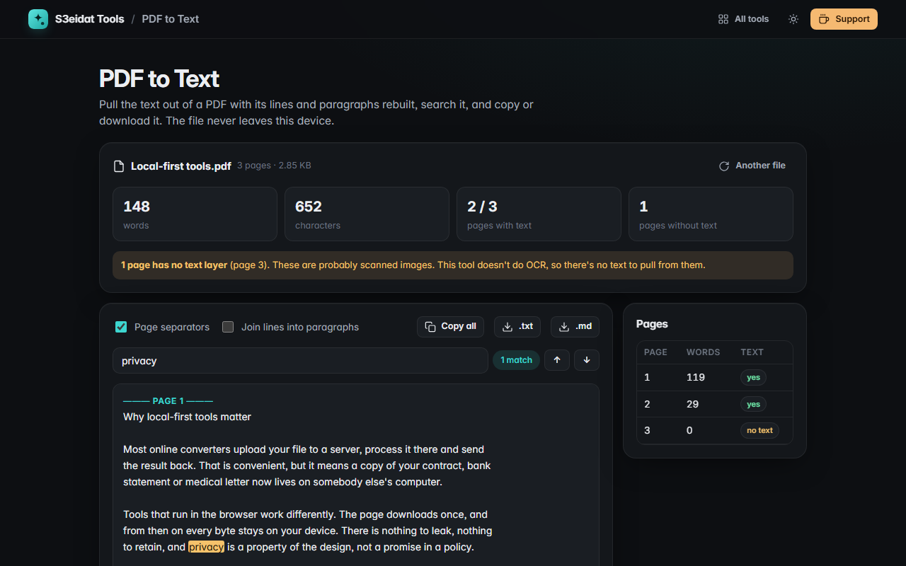

# PDF to Text

> Pull the text out of any PDF, with lines and paragraphs rebuilt. Search it, copy it, or download it as .txt or .md. Free, private, and it runs entirely in your browser.

### ▶ [Open PDF to Text](https://s3eidat.github.io/pdf-to-text/)



## Features

- Rebuilds **lines** from the position of each piece of text, adds the spaces PDFs leave out, and keeps **paragraph breaks**
- Optional **join lines into paragraphs** (and mends words split with a hyphen at a line end)
- Right-to-left lines (Arabic, Hebrew) are put back in reading order
- **Page separators** on or off
- **Search** with match count and next/previous
- **Per-page word counts**; click a page to jump to it
- Clearly flags pages with **no text layer** (scanned images)
- **Copy all**, download **.txt** or **.md**
- Progress and cancel for long documents

## Limits

- **No OCR.** A scanned page is a picture of text, so there's nothing to extract; the tool tells you which pages those are.
- Multi-column layouts and tables come out line by line, left to right, so columns may interleave.

## Privacy

Your PDF never leaves your device. There is no server, no account, no analytics.
The page ships with a strict Content-Security-Policy (`connect-src 'self'`), so the browser
itself blocks any attempt to send data anywhere. Text is read with [pdf.js](https://github.com/mozilla/pdf.js) (Apache-2.0), included in `lib/`.

## Run it yourself

It's plain HTML, CSS and JavaScript with no build step:

```bash
git clone https://github.com/s3eidat/pdf-to-text
cd pdf-to-text
python -m http.server 8000
```

Then open http://localhost:8000.

## Support

If this saved you time, **[buy me a coffee ☕](https://s3eidat.github.io/coffee/)**. It keeps every tool free.

---

Part of **[S3eidat Tools](https://s3eidat.github.io/)**: 100+ free, private tools that run in your browser. MIT licensed.
